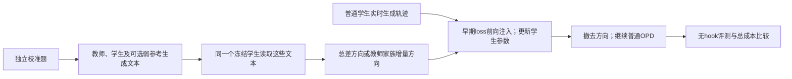

# 学生空间 Steering 辅助跨 Family OPD：完整研究方案

版本：2026-11-11。状态：**方案设计，实验与下载继续暂停**。本文件是方法与实验设计的
唯一主入口；论文原设置见[模型、数据与证据](02_paper_settings.md)，工程状态和恢复条件见
[执行与验收](03_execution_plan.md)。所有超参是待验证的起点，不是已有结果。

## 1. 问题、假设与最终目标

研究问题是：**对于同一个固定教师，不同学生所需的教学适配，能否由学生自身空间
中的少量激活方向表达，并按撤去干预后的学习收益选择，从而改善OPD？**

我们区分三个层次。先让不同tokenizer的监督事件具有可比的文本边界，再判断教师
监督是否提供学生可用的能力增量，最后检验学生内部干预是否帮助参数真正学会。
分词对齐不自动保证监督有用，输出分布更接近也不自动保证任务表现提高。

最终交付不是一个更高的overlap数字，而是：普通、无hook学生的可重复迁移收益；
相对SFT/LoRA、SV-SFT与Compass的价值；同一教师面向不同学生的效果与成本边界。
若已有方法足够，或真实方向与随机方向相当，应接受负结果。

| 待检验假设 | 必需证据 | 单独不足的现象 |
|---|---|---|
| H1：少量方向能够改善监督适配 | 相同前缀上的真实/随机/负方向比较，并排除明显格式、长度和覆盖率解释 | 只有教师初始分数更高 |
| H2：方向帮助参数学习 | 短程更新后撤去方向，独立dev表现及后续普通OPD曲线改善 | 开hook时overlap提高 |
| H3：教师家族增量比总差方向更有用 | 方案2与方案1在同初始化、同loss、同文本和范数尺度下比较 | 只将方案2与弱Vanilla比较 |
| H4：作用与学生有关 | 同教师的不同学生各提自己的方向，在各自空间内比较学习收益 | 直接比较跨模型向量坐标 |
| H5：收益不限于大教师教小学生 | 论文已有的4B→4B配对上重复，并报告真实参数规模与教师能力差 | 把MoE激活参数当成总参数 |

## 2. 与已有论文的关系

Rethinking OPD发现共享词表下也存在难以迁移的组合，提供overlap诊断、教师轨迹
SFT冷启动和模板控制。Simple-OPD提供同教师CoT→LoRA warm-up→OPD的强基线；
其GPT-5.5文本warm-up后仍有75步OPD，逐token教师是Qwen，未验证GPT→Qwen概率蒸馏。

Compass在对齐与共同SFT之后仍观察到迁移瓶颈，使用教师相对同家族弱参考的似然
变化，并以初始学生锚定。它还提供共同文本span评分规则。我们借用这些思想，
研究受限的学生内部干预。原论文的对齐和教师参考构造不是本项目的新贡献。

SV Training已经给出教师文本/学生文本由同一个学生编码、取激活差并干预训练前向
的先例。LastOPD、Latent-MOPD、OPMD等也覆盖内部辅助或早期撤去。新颖性不能由
组件组合自动推出；边界与阅读深度保留在[新颖性审计](09_novelty_audit_cross_family_steering_opd.md)。

## 3. 模型与数据面板

以论文实际出现的**整条教师—学生连线**为依据，不按参数量或下载便利自由拼接。

| ID | 教师T / 教师家族参考R → 学生S | 用途 | 论文对应与限制 |
|---|---|---|---|
| C1 | Qwen3-30B-A3B-Instruct-2507 / Qwen3-0.6B → Granite4.1-3B | 主要真正异构family实验 | Compass表2与A.1；教师/参考已有，Granite权重及精确发布映射待落实 |
| C2 | 同一Qwen3-30B教师 / Qwen3-0.6B → Qwen3-4B | 同教师、同family对照 | Compass §3.1已有配对；原初始化/数据与C1不同，跨组差异不能只归因family |
| C3 | **Qwen3.5-4B / Qwen3.5-0.8B → Qwen3-4B** | **4B级→4B级规模匹配控制** | Compass §3.1图1(b)已有4B教师配对；作为独立教师+学生组合出现过，但其Compass、steering新组是本项目扩展 |
| R1 | JustRL-1.5B及R1-Distill-7B → R1-Distill-1.5B | overlap成败机制与轻量warm-up对照 | Rethinking §4.1；JustRL配对也见Simple §5.3；不是独立family迁移 |

C3按Compass定义为跨family，仍共享广义Qwen谱系；其代际、架构和tokenizer差异
须单独实查。我们称其“同谱系、不同代际的4B级控制”，不拿它替代C1的独立family
证据。实际总参数、文本主干参数、激活参数、可训练参数及embedding占比均需记录。
Qwen3-30B-A3B与3B学生不能因为前者激活约3B，就被写成同总参数规模。

如果要求**独立family且同一标称规模**，可另讨论Ministral-3-3B-Instruct-2512→
Granite4.1-3B：模型分别作为Compass的参考/学生出现过，但这条3B教师连线属于
**新配对**，教师优势未验证，而且缺少已核实的更弱同家族参考，暂不定义其Compass/
方案2组，不列入首批。不能将同一个3B checkpoint同时当T和R。优先采用C3，避免
为满足“完全同大小”标签而重新随意下载或拼接。

原论文数据对应：C1的OPD用DeepScaleR-Preview，C2/C3的Qwen3学生用DAPO-Math；
Compass冷启动用同一教师重新回答的OpenThoughts-114k。Rethinking的200K SFT
使用OpenThoughts3数学域，另有约30K去重OPD题；与OpenThoughts-114k不同。
MATH-500保留冻结测试。具体本地资产、缺口与原版/适配版标注见第02篇。

主线先完成C1；C2复用教师检验学生差异；C3排除大规模教师独占的解释。R1仅作
原论文机制及工程对照，不再用同family结果顶替跨family主实验。

H4另设共同校准小面板：C1/C2使用完全相同的128道校准题、同一份T/R回答和同一
诊断题池，各学生只重新产生自己的回答与方向。建议从清理后的DAPO/DeepScaler
各预留64题，先做全局去重，并从两边OPD train/dev排除这些题。这个统一校准是
项目控制，不冒称论文原数据设置。原生题源面板仍各按论文记录；不同训练题源、
不同SFT起点的跨组差异不能单独证明适配方向具有学生特异性。

## 4. 数据、示范与隔离

### 4.1 划分和访问边界

训练题先按裸题去重，再排除MATH-500及已选其他测试的精确/词面近重复；语义污染
和预训练污染不能据此宣称完全消除。原始来源、处理脚本、排除记录与题目ID均保存。

| 子集 | 首轮建议 | 用途 |
|---|---:|---|
| calibration候选池 | 1,024题；先取128题，后比较32/128/512规模 | 所有方法共享的教师示范、学生回答、可选参考回答及向量发现 |
| OPD train | 先2,048题，正式用其余清理训练题 | 每次更新普通学生重新生成；与calibration/dev/test隔离 |
| dev-select | 128题 | 层、强度、方向数、H、SFT/LoRA超参选择 |
| dev-confirm | 另128题 | 冻结候选后的确认，不循环调参；旧16题诊断只放dev-select |
| 固定前缀诊断池 | dev-select中固定64题 | 相同题/普通学生前缀下开关方向比较 |
| MATH-500 | 500题 | 方案和超参冻结后的测试；不用于选择模型或方向 |

以上是项目控制实验，不声称还原论文全部数据规模。当前DAPO固定划分可复用，
DeepScaler本地40,315条处理版必须先核对题目集合/版本/重复和测试污染。

### 4.2 教师示范

对同一固定校准题，T先生成一次完整推理回答；S0也生成一次，方案2额外由R生成
一次。初始学生、模板、模式、seed与解码参数固定。每位学生分别生成自身回答，
T/R文本可在学生之间复用；不同初始化面板的学生自身回答不能复用冒充。

项目预检起点：教师max new tokens=12,288、temperature=0.7、top_p=0.95；
这是参考Rethinking离线生成的预算，不称为Compass默认。先以32道训练校准题
检查截断、重复、答案提取；截断超过5%时不按此预算确认教师能力，统一审定更大
预算并更新所有方法。原Compass复现另按其配置，不能用旧3072上限得出强弱结论。

主示范池保留完整、非退化回答，不以正确性作为唯一筛选，以对应Simple关于
CoT来源/错误轨迹的讨论；报告正确率。再做教师正确子集、T正确/R错误、T/R都正确
的消融，各组SFT与向量法获得相同文本可见性。参考模型不会的题也不能悄悄丢掉。
若优先采用正确示范，必须将其作为单独协议，报告为凑够M条生成的全部成本。

三文本比较使用相同题目ID的完整、非退化T/R/S回答，并将该子集的教师文本同样
提供给SFT和方案1。R回答错误不是排除理由；若R/S截断或没有可读内容，记录并在
预先固定候选池内补足，实际不足则报告真实M。不能让方案2独享容易题的选择优势；
完整三文本池的选择偏差另用等长可读前缀协议验证，不把两种池化版本混为一组。

### 4.3 “学生读一遍”的精确定义

T生成的回答文本，由冻结的S0用**学生自己的tokenizer和原生模板**读一遍，得到
回答token的内部激活；不读取T的hidden state。参考项是同一个S0读取自身回答。
所以方案1通常有每题两次学生prefill，方案2三次；可以批处理，不能将它记成整个
流程仅一次forward。仅在验证等价后，才复用生成阶段已捕获的学生激活。

这一步无需师生token逐个对应；后续概率OPD仍然需要独立的输出对齐。整个系统
通常需要教师概率，不能因为向量发现只用文本，就称为纯黑盒蒸馏。

## 5. 方案1：教师—学生总差方向

### 5.1 方向定义

记`Phi_j,l(x,y)`为冻结初始学生`S0_j`在block l读取回答y后的内容激活池化。
每题先池化，跨题等权平均：

`v_total[j,l] = mean_i(Phi_j,l(x_i,y_T_i) - Phi_j,l(x_i,y_Sj_i))`。

不是教师激活减学生激活；两项维度和坐标都来自同一个学生。方向固定于S0，不
随训练刷新，刷新另作消融。若共享SFT初始化改变，必须从新的S0重新提取。

主池化规则：只取回答内容，排除prompt、padding、role/EOS及结构标记；每条完整
文本一次prefill。在每对文本中取相同数量、最多512个内容状态，按各自回答的
相对位置均匀抽取后平均。再比较完整内容均值与等长前512 token池化，检验长度/
位置影响。不同长回答的prefix上下文仍可能不同，等数采样不等于完全消除长度混杂。

第一轮只用中间block，0-based层号按模型真实层数记录；之后仅在有信号时比较
约1/3、1/2、2/3相对层深，不在全模型逐层扫到一个好结果。

### 5.2 注入与作用域

对选中block输出，在回答**预测状态**加`alpha * v`。若回答token位于输入位置t，
预测它的是状态t−1，首个回答预测状态包含prompt的最后一个位置。

`alpha = rho * median_calibration(||h_l||) / ||v||`，诊断rho取0.01/0.03/0.1。
记录目标扰动比与BF16舍入后的实际扰动；向量近零时不强行归一化。随机向量与真
方向匹配层、范数、mask、强度和启用时长，至少3个随机方向种子。

**学生rollout始终无hook。** 方向只在早期loss前向启用并维持到backward/gradient
checkpoint重算结束。教师、弱参考、学生锚点、常规诊断和最终评测都关闭hook。
仅前H次更新带方向，随后移除并继续普通蒸馏；保存H、H+1、H+20及终点。

### 5.3 为什么可能有用，以及可能失败在哪里

假设是：方向暂时改变学生处理教师监督时的内部状态，让后续层产生更可学习的
梯度。也可能仅改变语气/格式，或者让模型依赖外部偏置、反而减少参数学习。
因此带hook即时改善不是成功标准，必须撤去方向并比较实际学习。

## 6. 参考Compass处理分词与评分

### 6.1 原论文的共同文本span

普通学生生成文本，T和R分别用自己的tokenizer重新编码，按共同文本边界单调
对齐。一个span可以对应双方不同数量的token。一对一直接用token log-prob；
多token span按Compass A.4取平均token log-prob，未对齐位置mask并报告覆盖率。

例如学生的`unbelievable`为1 token、教师为`un / believ / able`三token：
教师span评分为`ell_T = (log p1 + log p2 + log p3) / 3`，每个p条件于此前文本。
教师家族增量`Delta_T = ell_T - ell_R`分配给span内学生token，学生锚点变化在
自己的token位置计算。这是平均似然评分；指定token路径的整段文本log-prob应取
和，不能将平均值称为整词概率或精确跨词表KL。

原版Compass采样优势为`sg[Delta_T - beta*(log pi_theta - log pi_0)]`，论文beta=0.5。
T/R及pi_0冻结，pi_0是共同SFT后、OPD开始时的学生。原版无hook基线按此复核。

### 6.2 为什么不能直接给原采样公式加hook

轨迹来自普通学生，带hook模型的条件分布不同。将普通学生采到的token直接当作
steered policy样本，套用未修正的reverse-KL策略梯度，不是正确的估计。
仅detach advantage或加入PPO旧策略比率也不自动消除这项分布差异。

因此方法消融第一版采用下一节的**显式有限候选分布目标**，在普通学生前缀上枚举
候选，直接求可微KL，不对被采样单个动作套用错误估计。原论文采样基线另列。
这是一个明确的接口适配，不能声称原版Compass加hook无需任何目标变化。

### 6.3 方法面板的可执行数学目标

在本次更新的无hook学生前缀c上，取普通学生top-K个next-token候选，将其解码为
当前上下文之后的可见续写文本。原始student token IDs保留；候选在该次更新内
固定，不对top-K选择求导。教师/参考在各自native prompt后读取相同可见前缀。

首版只保留：有效UTF-8、非控制角色、可稳定拼接，并且对T/R有稳定编码前缀边界
的候选；至少2个候选才计算loss。重复解码文本合并并对学生概率求和；EOS是单独
终止事件，概率按本模型的合法停止token聚合。不能用strip抹掉空格，不能把token
ID相等视为异构模型语义相等。原前缀也必须完整encode/decode round-trip。

每个候选可由教师多个token表示，按同样的`sum/mean`显式配置取其条件log-likelihood。
主方法面板使用Compass式mean，sum作稳健性消融；所有方法共用同一评分口径。
如果编码跨越prefix边界，首版跳过并统计；扩大为更长公共span属于后续接口版本，
不能默默改写学生采样历史。

记`b_j^v`为带hook学生对保留候选j的原始概率，`p_j^v = b_j^v / sum_k b_k^v`；
无hook时v=0。记教师候选评分为`ell_T,j`、弱参考为`ell_R,j`，冻结学生在同一候选
集上的归一化概率为`p_0,j`。所有目标都在本次固定的有限候选集C上定义：

`q_V,j = softmax_j(ell_T,j)`；

`q_C,j = softmax_j(log p_0,j + (ell_T,j - ell_R,j) / beta)`；

`L_V = sum_j p_j^v * (log p_j^v - log q_V,j)`；

`L_C = beta * sum_j p_j^v * (log p_j^v - log q_C,j)`。

`q_C`来自Compass式(11)的有限候选目标，beta起点0.5。T、R、p_0、候选集及方向
均停止梯度；只有学生theta更新。每步普通学生重新rollout；固定前缀诊断缓存不
拿来代替整个训练的实时轨迹。关闭方向后使用同一目标继续训练。

这一定义解决了本方法实验的采样/前向不一致：在固定访问状态上直接枚举候选并
求导，不需要假装动作来自带hook策略。它是有限候选reverse KL，不是完整词表/
完整文本分布KL，也不包含对离散rollout状态采样过程求导。

不同候选文本可能互为前缀，教师mean分数也不是互斥事件概率。因此`q_V/q_C`是
明确定义的归一化偏好目标，不把教师候选分数之和称为覆盖率。共享词表、一token
且完整保留原生事件时可对应Student Top-K归一化目标；跨tokenizer不能直接如此宣称。

### 6.4 原版与适配版分开比较

所有方向消融共用`L_V`或`L_C`、候选和位置规则，以隔离方向贡献。报告名称为
Vanilla-Candidate / Compass-Candidate adapted。另保留原版无hook的Vanilla-span /
Compass-span采样目标，复核论文趋势并作为成本匹配强基线。
若只有candidate面板成立，主张限定在这个接口；不能据此声称已改进原版所有OPD。

首轮工程目标K=8、每回答4个固定分位位置；通过后比较K=16、16个位置。所有方法
一致；记录位置覆盖、有效候选数、学生保留质量、丢弃原因和每候选教师token数。
这部分教师评分可能很贵，必须独立计时，不能把“一次学生prefill”当整个训练成本。

## 7. 方案2：教师家族增量方向

### 7.1 从Compass的分解得到一个受限表示假设

Compass在相同动作上的log-likelihood分解为“弱参考相对学生的偏移”加“强教师相对
弱参考的变化”。我们检验这个思路能否形成学生空间的更有用方向。

在相同校准题上取得T、R、S0三种回答，三者均由同一个S0读取。为保证下面分解的
代数意义，**三者共享同一个池化协议和共同样本权重**：每题内容采样数取三者长度
的最小值、最多512；同一来源的Phi在不同方向中不可重新换长度或mask。

`v_cap = mean_i(Phi(x_i,y_T_i) - Phi(x_i,y_R_i))`；

`v_offset = mean_i(Phi(x_i,y_R_i) - Phi(x_i,y_S_i))`；

`v_total_triplet = v_cap + v_offset`。

真实比较使用这个三文本协议重新计算的`v_total_triplet`，不能把方案1另一池化
规则所得向量直接带入并宣称严格分解。若额外加权，所有项用相同权重才保留恒等式。

### 7.2 需要验证的内容

主候选是`v_cap`：尝试保留教师同家族内的增量，减少把弱参考也有的跨family偏移
全部传给学生。`v_offset`单独注入是关键反证对照；还要比较总差、随机与负方向。

名称cap只表示设计意图。T与R的自由生成回答在内容、长度、正确性和风格上都可能
不同，表示差不自动是纯能力方向；同family也不保证风格完全相同。这不是Compass
log-likelihood恒等式在隐藏空间中的证明。应加入格式/长度匹配、正确性分组，
必要时让T/R从同一个校准前缀继续生成，检验内容差异是否解释结果。

方案2增加R生成、R文本的学生prefill及参考评分成本。教师端的log-ratio是否改善
监督，与学生方向是否改善计算是两个因素，必须分开消融：

| 学生方向 | 普通教师候选目标L_V | Compass候选目标L_C |
|---|---|---|
| 无 | E0 | C0 |
| 总差方向 | E3：方案1 | C1_TOTAL |
| 教师家族增量方向 | E5_CAP：方案2 | C2_CAP |
| 同范数随机方向 | E4 | C3_RANDOM |

相同信息面板中，即使某组不使用R，它也可以使用同一批已生成文本做合理SFT/LoRA
候选；另保留严格只用T文本的标准baseline。分别报告固定信息与实际各方法所需
信息的成本，不能通过独占额外R示范把收益全部归给方向构造。

若C2_CAP最好，也要先确认它优于C0、C1_TOTAL及C3_RANDOM，才能将收益归于方向
构造和组合价值。不能只比较“方案2+Compass”与“方案1+Vanilla”。

## 8. 单方向、少方向与按学习收益选择

先验证一个全局方向。中层rho三点仅用于诊断，选取进入训练的候选必须做真实
参数更新：从同一个S0分别运行短程OPD，在关闭hook后比较dev-select结果。

首轮最多6个真实候选：两种方向×三个rho；E0与至少3个随机方向种子共享搜索
预算并单独计费。各候选先10步，再仅对有信号者确认至50步；不因为10步没有显著
准确率差异就宣布理论失败，也不无限扩大网格寻找正结果。先看更新/梯度正常、
无hook监督响应，再看准确率和后续普通OPD收益，所有判断记录。
选定正向候选后，至少追加同层同强度负方向的短程学习对照，成本单列；若负方向
更好，就不能继续用“向教师靠拢改善学习”的解释，需重新审定干预符号和机制。

若单方向有可重复收益，再试2/4个方向。按校准题的学生题目表示聚类，分别提取
方向；新题只根据题目路由到固定中心，方向仅在loss前向使用。聚类、中心及路由
不看dev/test答案；随机分组和同数量随机方向为对照。每个学生独立做这些步骤。
同一题目表示可从已有prefill的prompt末状态复用，但须先验证与独立prefill等价。

主要选择标准：固定预算下无hook dev收益、撤去后保持程度及后续普通OPD曲线，
同时计总成本。overlap仅作解释。dev-confirm只在配置冻结后使用一次；失败时
记录失败，若重新调参就不能继续称同一confirm集未被使用。

## 9. 两个初始化面板与SFT公平比较

### 面板A：能否替代或减少冷启动

各组从原始学生出发，共享M条教师示范和校准题：无辅助OPD、full SFT→OPD、
LoRA→merge→OPD、SV-SFT→OPD、方案1、方案2及随机方向。
SFT获得同一批教师推理文本，不仅给它最终答案；各组有合理调参机会。

主资源口径：以Vanilla的实测GPU-hours/教师评分预算为基准，报告学习曲线及同预算
处表现。另报相同学生更新数：如300次预算中，方向法前40次辅助+260次普通；
SFT法40次warm-up+260次OPD；普通组300次OPD。SFT与OPD更新成本不同，这不等于
算力匹配。再单列论文式“完整warm-up额外加完整OPD”的强基线与实际成本。

LoRA起点rank32、all-linear、LR5e-5，full SFT起点LR5e-6；rank16/64和训练接近
饱和的时长在dev上合理搜索。SV-SFT也要真实实现；不能把一个欠训练SFT当对手。
LoRA合并后验证参数确实变化，且无adapter推理与合并前一致。

### 面板B：共同SFT后是否仍有独立价值

按Compass设定取得同一个教师轨迹SFT checkpoint，所有Vanilla、Compass、
方案1/2及组合都从它开始，pi_0冻结在这个起点。方向、学生自身校准回答重新计算，
T/R文本可复用。不能让Compass独占SFT，也不能给方向法额外的隐含SFT。

完整OpenThoughts-114k生成+SFT属于原论文预算，当前未落实；若只用数学子集或
小样本，明确写共同SFT的实际规模及adapted。面板B只能证明SFT后有附加收益；
“省掉SFT”的结论必须来自面板A。两面板不能混成一张起点不同的胜负表。

## 10. 诊断、机制与指标

### 10.1 固定前缀诊断

每位S0用无hook轨迹产生自己的固定前缀池。后续方向测试保持同一学生token历史、
同一教师评分和同一比较接口。按起始、中段、后段及特殊格式位置分组；在不同学生
之间比较时注明其轨迹内容本来不同。

共享词表报告原生`Overlap@16 = mean(|top16_S intersect top16_T|/16)`，另报共同
候选上的双方原始质量、熵和置信度。97%–99%来自Rethinking相关实验的概率质量，
不是可删除的序列位置比例，也不是本项目的保证。

异构tokenizer报告共同span覆盖、对齐评分、保留学生质量；literal continuation
overlap和首字节重合仅作辅助，分别命名。首字节大量相同可能只是空格；不比较
原生token ID交集，也不把不同粒度原生熵当成同一量。

### 10.2 区分即时改变与参数学习

1. 未更新模型：无hook、alpha0、真实、随机、负方向；移除hook后应恢复原输出。
2. 短程学习：相同起点更新后关闭hook，比较dev准确率、长度、截断、重复及教师文本
   监督响应；无hook NLL/候选KL改善只是次级证据。
3. 撤去后继续：比较H、H+1、H+20及终点曲线；主要结果来自最终普通学生。
4. 控制位置与格式：排除首句/空白后是否仍有诊断变化；内容长度匹配、统一答案格式、
   真实/负/随机、早/中/晚相同H以及整程注入。

可选机制分析为少量位置的梯度方向/范数及其聚合关系。Rethinking的梯度抵消只是
未证实假说，本项目也不能仅凭大advantage、小gradient norm就宣称完成因果解释。

### 10.3 任务结果与统计

MATH-500为主，已有AIME24/25和明确题目清单的AMC为补充。全方法统一采样协议，
avg@n不写成pass@n。项目统一面板建议MATH avg@4、AIME avg@16；与Compass文献
表格直接对应时，另按其MATH avg@16和解码设置报告，不混用七项平均分。

筛选1个训练seed，正式至少3个；报告每seed与均值/标准差，按题配对bootstrap。
一题的多样本或多个前缀不能当独立题扩充n。不能以16题dev的单次结果定教师强弱，
也不能把多个候选中的最好一项当无搜索成本的主结果。

主要终点预注册为无hook准确率和同预算收益；若准确率相当但成本更低，按预先
确定的非劣界与成本指标报告，不临时改变“成功”定义。OOD保留性先用已有MMLU-Pro
子集，IFEval等作为后续项，数据未就绪时不虚报。

## 11. 成本、工程与EasySteer

逐项记录：T/R/S示范生成token与GPU时间、S0每种文本prefill、层/方向搜索、
SFT/LoRA与merge、rollout、教师/参考/学生锚点评分、更新、评测及模型加载时间。
方案1相对SFT是否便宜由账单决定；方案2额外R调用必须计入。固定数据缓存可在
方法之间复用，但同时报告一次性研究成本和每方法独立部署成本，不能让某组承担
全部共享开销而其他组免费。

普通生成用已验证vLLM，提取先用HF；训练用可微PyTorch/verl hook。EasySteer只
作为capture/带方向推理诊断的后续加速候选，先对齐相同IDs、层、mask、池化和精度。
其冻结主干的adapter training API不能替代本方案的学生主干更新，也没有依据将
论文推理加速倍数套到完整训练。128题的提取可能不是瓶颈，先计时再决定优化。

现有72GB卡上30B教师短前缀评分曾成功，不代表长前缀、Granite训练或Qwen3.5均
可直接运行。恢复后先profiling；多引擎不能各自占同卡90%显存。可以阶段性串行
复用卡，持续训练的教师/参考/actor资源按实际显存分配。启动前重新检查nvidia-smi，
只使用空闲卡，绝不终止其他项目进程。

## 12. 阶段、继续条件与失败处理

| 阶段 | 交付 | 进入下一阶段的条件 |
|---|---|---|
| P0：方案与资产核对 | 论文对应、revision/数据版本、原版或adapted、预算 | 用户明确恢复；缺口按固定清单处理，不能自行换配对 |
| P1：原始诊断与接口 | 无hook前缀、共同事件、边界覆盖、教师/学生dev能力 | 实际可评分且可靠；不能只看启动成功 |
| P2：向量与即时诊断 | 总差/增量/偏移、随机/负方向、mask/零强度检查 | 无泄漏、作用域正确，诊断解释清楚；不因overlap最高直接选最终方向 |
| P3：真实学习筛选 | 从相同S0短程更新、无hook dev和撤去后曲线 | 有足够证据决定继续/修改/记录负结果；先验证无辅助目标能学习 |
| P4：强基线与组合 | 面板A/B及原版span基线、成本曲线 | 优势不能由起点、目标、长度、覆盖或搜索预算解释 |
| P5：正式结果 | C1/C2/C3、3 seeds、冻结测试、OOD/时段消融 | 得出有范围的结论；不自动宣布所有family都解决 |

工程保护阈值先固定：UTF-8/round-trip不一致不强行归一化；候选少于2个跳过并
记录；有效诊断位置不足计划70%则停止解释学习差异，先修接口。此阈值是项目预检
标准，不是论文阈值；修改需全方法同步并重新冻结。确认评测截断超过5%时先解决
长度预算，不能据其确认教师优势。

原始OPD无收益时，先排查教师能力、接口、模板、长度与更新语义；有其他有效基线
时可将其作为难迁移案例，不能将任何失败都解释成需要steering。真实方向不优于
随机则不支持方向专属性；增量方向不优于偏移方向则收窄方案2解释；只在开hook
时有效则不能声称改善部署学生；未超越强基线则报告相应负结果。

## 13. 当前已经确定和仍需决定的事项

已确定：两套方向定义、分词/目标边界、同信息SFT/LoRA比较、共同SFT后的Compass
组合、4B级规模控制、按无hook学习收益选择，以及保持暂停。已有工程和探索结果
仅作接口参考，没有正式论文配对上的方法有效性结论。

恢复前须完成：C1的Granite发布ID/revision与SFT初始化获取方式；C3教师4B权重；
DeepScaler数据等价性；完整SFT与小预算面板的成本；新架构hook和训练接口验证。
**本方案不是下载/运行授权。** 可执行进度和待办统一维护在[AGENTS](../AGENTS.md)。
